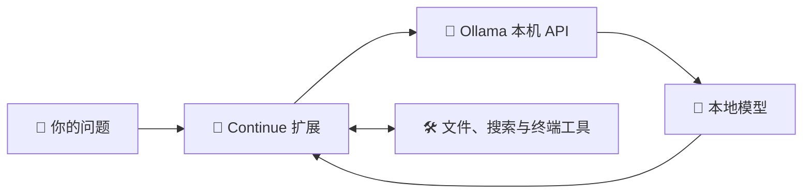

<div align="center">

# 🖥️ Agents of Local · 本地 AI 编程助手

**让模型在自己的电脑上运行，让配置和工具掌握在自己手里。**

🦙 Ollama · 🧩 Continue · ⚡ 本机推理 · 🔧 可修改配置

[快速开始](#quick-start) · [修改配置](#configuration) · [AMD 部署](docs/ryzen-deployment.md) · [常见问题](#faq)

</div>

---

## 👋 这是什么

这是一个面向 Windows 笔记本的本地大模型部署项目：用 **Ollama 运行模型**，通过 **Cursor 中的 Continue 扩展**完成对话、读文件、搜索代码和编辑等任务。

项目保留了简单的 PowerShell 脚本、模型配置和 Python API 示例，方便学习、调整参数，以及在另一台电脑上复现。



模型负责生成回答和提出工具调用；Continue 执行工具并返回结果。首次下载程序、模型和扩展需要网络，本项目模型推理使用本机 API。

## 📍 当前状态

> 更新于 **2026-11-05**。RTX 4060 本机部署及 API 验证已完成；AMD 机器提供部署指南，尚未实测。

| 项目 | 当前情况 |
| --- | --- |
| 已验证设备 | RTX 4060 Laptop · 8GB 显存 · Windows 11 |
| 运行环境 | Ollama `0.40.14` · Continue `2.0.0` |
| 基础模型 | `qwen3.5:4b-q4_K_M` |
| 本地模型别名 | `local-coder-4060` |
| 当前参数 | **32K 上下文** · 最多输出 2048 tokens · 温度 0.2 |
| GPU 验证 | `100% GPU`，32K 配置下模型占用约 **4.1GB** |
| API 验证 | 中文生成、工具调用、工具结果回传均通过 |
| 编辑器验证 | Continue 面板、模型选择及双侧栏布局已确认；受控的读写文件验收仍待完成 |
| 外挂知识库 | 尚未实现，后续可通过 MCP 接入 |

上述显存数值是当时测试结果，不代表整机显存总占用，也不代表复杂编码任务准确率。

验证记录：[32K 工具调用](docs/evidence/2026-11-05-context-32k.json) · [早期 8K API 测试](docs/evidence/2026-11-05-api-verification.json)。

<a id="quick-start"></a>

## 🚀 快速开始：RTX 4060

### 1. 准备环境

- Windows 11，兼容的 NVIDIA 驱动。
- 已安装 Cursor；API 示例及检查脚本需要 **Python 3.11+**。
- 建议预留至少 **15GB** 磁盘空间，容纳运行包、解压文件和模型。
- 在**项目根目录**打开 PowerShell，执行下面的命令。

本路线使用项目内的独立 Ollama 运行包。AMD 机器请按 [AMD / Ryzen 指南](docs/ryzen-deployment.md)部署，不直接照搬 NVIDIA 运行环境。

### 2. 安装运行环境

```powershell
powershell -ExecutionPolicy Bypass -File .\scripts\install-runtime.ps1
```

脚本下载固定版本的官方运行包并校验 SHA256。**已安装好的本机无需重复执行**；发现现有运行目录时，脚本会停止，避免直接覆盖。

### 3. 启动本机服务

在一个单独的 PowerShell 终端运行，保持该终端开启：

```powershell
powershell -ExecutionPolicy Bypass -File .\scripts\start.ps1
```

项目服务地址为 **`http://127.0.0.1:11435`**。本机另有服务使用 11434，因此本项目选用 11435；启动前确认端口未被占用。

### 4. 下载模型并验证

在另一个 PowerShell 终端运行：

```powershell
powershell -ExecutionPolicy Bypass -File .\scripts\setup.ps1
powershell -ExecutionPolicy Bypass -File .\scripts\check.ps1
python .\examples\chat.py
```

`setup.ps1` 会检查基础模型，缺少时下载，再按 Modelfile 创建别名。检查成功时应看到：

```text
PASS: tool call and result round trip
```

GPU 分配以实际输出的 `PROCESSOR` 为准，当前配置的 `CONTEXT` 应为 `32768`。

### 5. 连接 Continue

在 Cursor 安装扩展 **`Continue.continue`**。将 [配置模板](continue/config.yaml)合并或复制到：

```text
%USERPROFILE%\.continue\config.yaml
```

**已有配置先备份，再合并模型条目。** 本仓库的 `continue/config.yaml` 是模板，不会自动同步到用户目录。

在 **Cursor IDE 编辑器窗口**中，按 `Ctrl + Shift + P`，选择 **`Continue: Add to Chat`**。在 Continue 面板选择 **Local Coder 4060 → Agent**；本地模型无需填写云端 API Key。

> 💡 Cursor Agents 窗口与 IDE 编辑器窗口不同。若搜索不到扩展命令，先切到 IDE，再打开命令面板。

### 6. 验证编辑器文件操作

打开 `examples/agent-sandbox`，向 Continue 发送：

> 读取 greeting.py，把返回值改为“你好，4060”，然后运行文件确认输出。

检查它是否实际读写文件并运行。API 工具调用通过，不等于编辑器中的文件操作已经通过。

<a id="configuration"></a>

## 🔧 修改配置

| 想调整什么 | 修改文件 | 如何生效 |
| --- | --- | --- |
| 模型运行参数 | [Modelfile](profiles/rtx-4060/Modelfile) | 修改后重新运行 `scripts/setup.ps1` |
| Continue 模型和上下文预算 | [配置模板](continue/config.yaml) | 同步到用户目录实际配置，再确认 Continue 已重新加载 |
| Python 请求、提示词、工具定义 | [chat.py](examples/chat.py) | 修改后运行该示例 |
| Agent 工作习惯 | [精简规则模板](continue/rules/local-agent.md) | 按 [规则说明](continue/README.md)安装到目标工作区 |
| 服务地址、模型存储位置 | [start.ps1](scripts/start.ps1) | 修改后重启服务，并同步所有调用端地址 |

当前模型参数：

```text
PARAMETER num_ctx 32768
PARAMETER num_predict 2048
PARAMETER temperature 0.2
```

- **上下文**：`num_ctx` / `contextLength`，包含提示词、历史、工具、检索内容和输出空间。
- **输出上限**：`num_predict` / `maxTokens`，限制单次生成长度。
- **温度**：`temperature`，控制采样随机程度，不是准确率开关。

改变上下文和输出上限时，同步修改 Modelfile 与 Continue 配置；Python 示例也有自己的请求参数。若更换基础模型，还需要检查 `setup.ps1` 中的固定下载标签和所有调用端的模型名称。

## 📁 项目结构与文件位置

```text
Agents_of_Local/
├─ README.md                     项目入口与当前状态
├─ profiles/
│  ├─ rtx-4060/Modelfile          RTX 4060：4B / 32K
│  └─ ryzen-ai-9/Modelfile        AMD 简单对话起步：4B / 8K
├─ continue/
│  ├─ config.yaml                Continue 配置模板
│  ├─ README.md                  规则使用说明
│  └─ rules/local-agent.md       精简 Agent 规则模板
├─ scripts/                      安装、启动、下载与检查
├─ examples/
│  ├─ chat.py                    Python 标准库 API 示例
│  └─ agent-sandbox/greeting.py   编辑器操作测试文件
├─ docs/                         AMD 指南、设计、计划与证据
└─ .local/                       本机程序、模型、日志；Git 忽略
```

| 内容 | 本项目的位置 |
| --- | --- |
| Ollama 运行程序 | `.local/ollama/` |
| 模型权重与清单 | `.local/models/` |
| 本机运行日志 | `.local/logs/` |
| Continue 实际配置 | 用户目录 `%USERPROFILE%\.continue\config.yaml` |
| 项目规则启用位置 | 目标工作区 `.continue/rules/`，以及自动发现的 `AGENTS.md` |

Ollama 的默认模型目录是 `%USERPROFILE%\.ollama\models`；本项目通过 `OLLAMA_MODELS` 指定了不同位置。

## 💻 另一台 AMD / Ryzen 电脑

请阅读 **[Ryzen AI 9 365 部署指南](docs/ryzen-deployment.md)**。

指南涵盖官方安装器、Continue 配置、CPU / GPU 检查和 9B 模型尝试。AMD 配置先以 4B / 8K 做简单对话基线；Agent 的系统提示词较大时，需同步提高上下文并实测内存和速度。集显加速与性能尚未在该机器验证。

<a id="faq"></a>

## 🧰 常见问题

### Message exceeds context limit

本机曾以 8K 窗口运行 Agent，但工作区规则使系统提示词约占 12.9K tokens，工具说明另占约 1.7K，因此请求在发送前被拦下。当前 RTX 4060 配置已统一改为 32K。

Continue 会裁剪可移除的历史，但必需提示词本身超限时，仅清空历史不能解决问题。检查当前启用的规则、工具及附带文件，避免重复加载长文档。

**增加短规则不会取消原有长 AGENTS.md 的自动加载。** 精简时保留必要约束，将详细流程改为按需读取；见 [规则使用说明](continue/README.md)。

### 文件列表和 Continue 不能同时显示

单独移动 Continue 视图：

```text
Ctrl + Shift + P
→ View: Move View
→ Continue
→ New Secondary Side Bar Entry
→ 回车确认
```

若整个主侧栏已被移到右侧，再执行 **View → Appearance → Move Primary Side Bar Left**，最后选择右侧的 Continue 标签。拖动分隔线调整宽度。

### 模型下载提示 DNS 错误

`lookup registry.ollama.ai: no such host` 表示仓库域名解析失败，先检查网络和 DNS。

项目提供备用工具：

```powershell
python .\scripts\download-model.py
```

它从官方仓库取得模型清单，下载后逐层校验 SHA256。只有独立核实了官方域名的当前解析结果时，才使用 `--registry-ip <当前核实的地址>`；该参数仅影响当前进程，仍校验 HTTPS 证书，不修改系统 DNS。不要照搬旧 IP。下载完成后重新运行 `setup.ps1`。

### 如何停止服务

前台运行 `start.ps1` 时，在对应终端按 **Ctrl + C**。

如果服务由后台进程启动，先用 `netstat -ano` 核对 **11435** 的实际监听 PID 和可执行路径，再停止本项目进程。`.local/ollama.pid` 若存在，记录的是当时的包装进程，可能已过期；不要据此直接停止未知进程。本项目未配置开机自启动。

## 📦 Git 复现与资料

仓库保存脚本、配置、规则模板和轻量验证证据；`.local/` 中的程序、模型权重及原始日志不纳入 Git。换机后需要重新下载程序与模型、安装 Continue、同步用户配置并启动服务。

模型标签可能随时间更新，验证记录中的摘要可用于核对当时版本。模型与第三方软件按各自许可使用和分发。Git 暂存、提交和推送由用户执行。

- 📝 [部署设计](docs/2026-11-05-4060-deployment-design.md)
- ✅ [实施计划与问题记录](docs/2026-11-05-4060-plan.md)
- ⚡ [32K 验证证据](docs/evidence/2026-11-05-context-32k.json)
- 📚 [Ollama Windows 文档](https://docs.ollama.com/windows) · [Continue 配置文档](https://docs.continue.dev/reference)

---

<div align="center">

🖥️ **本机运行 · 🔍 按需读取 · 🛠️ 逐步定制**

</div>
