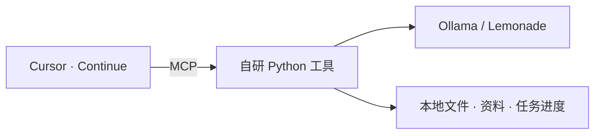

# 🧠 Agents of Local

**在自己的电脑上跑模型，在 Cursor 里用自己写的工具。**

⚡ 本地 GPU / NPU　·　🧩 Continue + MCP　·　🐍 Python

[AMD 纯 NPU 安装](docs/amd-npu-installation.md) · [Ollama 安装](docs/continue-installation.md) · [工具源码](local_tools/artifacts.py) · [鹈鹕演示](鹈鹕测试/index.html)

---

## 🚀 从这里开始

| 你的环境 | 阅读入口 |
| --- | --- |
| ⚡ **AMD Ryzen AI，使用 Lemonade / FastFlowLM** | [AMD 纯 NPU 接入教程](docs/amd-npu-installation.md) |
| 🦙 RTX 4060 或已使用 Ollama | [从源码接入 Continue](docs/continue-installation.md) |
| 🖥️ AMD 集显，打算使用 Ollama | [Ryzen 的 Ollama 部署](docs/ryzen-deployment.md)，再按 Continue 教程注册工具 |

接入后，在 Cursor 的 **Continue → Agent** 中试一句：

> 请调用 generate_html_file，生成一个显示 LOCAL MCP READY 的单文件 HTML，文件名为 hello-local.html。

文件保存在 `.local/artifacts/`。资料放在 `.local/knowledge/`，跨会话任务状态保存在 `.local/task-state.sqlite3`。

## 🧩 模型和工具怎么配合

Python 工具负责文件交付、复读检测与一次恢复。它会按预算选入本地资料，并在新会话中恢复已保存的任务。想添加自己的能力，从 [`@server.tool()` 所在的模块](local_tools/artifacts.py) 开始。

## 🗂️ 仓库怎么读

| 路径 | 内容 |
| --- | --- |
| [local_tools/](local_tools/) | MCP 工具、复读检测、预算、知识库和任务状态 |
| [tests/](tests/) | 回归测试，运行 `python -m unittest discover -s tests` |
| [docs/](docs/) | 安装教程、设计、历史经验和实测证据 |
| [scripts/](scripts/) · [profiles/](profiles/) · [continue/](continue/) | 启动脚本、模型参数和 Continue 配置示例 |

`local_artifacts.py` 是 MCP 启动入口，实际实现位于 `local_tools/`。模型权重、本机生成的 MCP 配置和 `.local/` 数据需要在新机器上分别准备。

想查过往尝试，可读 [部署排障经验帖](docs/2026-11-06-local-ai-experience.md)、[4060 部署与历史排障](docs/4060-deployment.md) 和 [鹈鹕实验产物](鹈鹕测试/index.html)。
