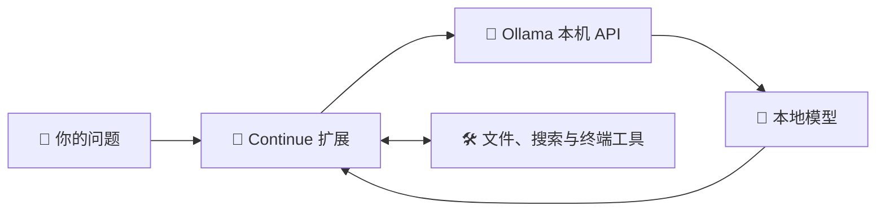

<div align="center">

# RTX 4060 部署与历史排障

**让模型在自己的电脑上运行，让配置和工具掌握在自己手里。**

🦙 Ollama · 🧩 Continue · ⚡ 本机推理 · 🔧 可修改配置

[快速开始](#quick-start) · [从源码接入 Continue](continue-installation.md) · [修改配置](#configuration) · [AMD 部署](ryzen-deployment.md) · [常见问题](#faq)

</div>

---

## 👋 这是什么

这是一个面向 Windows 笔记本的本地大模型部署项目：用 **Ollama 运行模型**，通过 **Cursor 中的 Continue 扩展**完成对话、读文件、搜索代码和编辑等任务。

项目保留了简单的 PowerShell 脚本、模型配置和 Python API 示例，方便学习、调整参数，以及在另一台电脑上复现。



模型负责生成回答和提出工具调用；Continue 执行工具并返回结果。首次下载程序、模型和扩展需要网络，本项目模型推理使用本机 API。

## 🔌 在 Continue 调用自研 Python 工具

首次获取源码或换电脑，请按 [从源码接入 Cursor 的 Continue](continue-installation.md) 安装。教程包括 Ollama 模型准备、Continue 用户配置、项目级 MCP 注册和一次实际写入验证。

本机已配置 `local-artifacts` MCP 服务。在 Cursor 打开本仓库，切到 **Continue → Agent**，选择支持工具调用的本地模型，然后发送：

> 请调用 generate_html_file，生成一个 SVG 鹈鹕骑自行车的单文件 HTML，文件名为 pelican-local.html。返回工具报告的路径。

工具通过 Ollama 11435 调用 `local-coder-4060-9b`，使用 8K 上下文和 4096 输出预算。结果保存在 `.local/artifacts/`。截断会返回 `truncated`，同一任务的已确认结果会返回 `reused`，同名冲突会返回 `conflict`。换一个文件名即可进行新的生成实验。Continue 仍按当前工具策略处理批准。

换机后，在项目根目录安装依赖并生成当前机器的配置：

```powershell
python -m venv .local/continue-mcp
& ./.local/continue-mcp/Scripts/python.exe -m pip install -r requirements-mcp.txt
& ./.local/continue-mcp/Scripts/python.exe local_artifacts.py --configure
```

`--configure` 将当前 Python 和脚本路径写入 `.continue/mcpServers/local-artifacts.local.json`。执行 `Developer: Reload Window` 后，在 Continue 的 **Tools → MCP Servers** 核对服务状态。需要使用同一 Ollama 服务上的其他模型时，在配置的 `local-artifacts` 对象中设置 `"env": {"LOCAL_ARTIFACT_MODEL": "模型名称"}` 后重载。

工具实现和验证分别见 [Python 模块](../local_tools/artifacts.py)、[接入设计](2026-11-07-continue-mcp-design.md)及 [MCP 实测记录](evidence/2026-11-07-continue-mcp-verification.json)。

工具内部使用 Ollama 流式接口，[退化检测模块](../local_tools/generation_guard.py)分别观察思考和正文。短片段连续重复至少 32 次且占至少 96 字符时，检测器关闭响应流并标记 `degeneration`，该次输出不会保存。检测跳过含常见标记字符的重复片段，以减少对正常 SVG 标签的误判。中止时如果后端未给出 token 数，结果记录已观察到的流事件数。现有 Continue 窗口需要重载才能让 MCP 进程加载新版代码。

4060 上使用 9B 进行真实 MCP 对照，诱发数字复读后约 8.9 秒中止，Ollama 记录了任务取消。后续正常 SVG 请求生成 864 tokens 并保存。见 [连续复读实测](evidence/2026-11-07-generation-guard-verification.json)。

短句轮换检测将近 24 个短句归一化后计数，若只有 2 至 6 种短句、每种至少出现 3 次，则以 `pattern: sentence_rotation` 返回。它检查思考和出现 HTML 标记前的正文；原有连续复读检测继续覆盖整段正文。受控 Ollama 文本请求在约 2.9 秒中止，后续标准交付流程生成 SVG 并保存。阈值与其他任务的误报率仍待进一步评估。见 [短句轮换实测](evidence/2026-11-07-sentence-rotation-verification.json)。

首轮退化后，交付工具保留原任务与文件名，开启一次新的生成请求。失败轮的部分输出不会进入重试。恢复成功时只保存最终结果，两次都退化则返回 `degeneration`。`attempts` 分别记录每轮的结束原因、耗时和已知 token 数。截断、连接错误和文件冲突各自返回，避免重复执行。

[上下文预算](../local_tools/context_budget.py)在 8K 窗口中默认预留 4096 tokens 给输出。工具可接收可选的 `references` 文本片段列表，按优先级纳入能放下的完整片段。任务要求保留原文，任务本身超额时直接返回 `context_overflow`。输入用 UTF-8 字节数加模板余量做保守估算，工具同时记录实际生成中 Ollama 返回的输入 token 数。`context` 中的资料编号从 1 开始。

本地知识库读取 `.local/knowledge/` 下的 Markdown 与 TXT。用 `search_knowledge` 检查片段和出处，或给 `generate_html_file` 传入 `knowledge_query`，让工具检索并按预算纳入资料。目录设置和试用方法见 [Continue 安装教程](continue-installation.md#6-使用本地知识库)。

多轮任务可用 `start_task` 保存原始要求与步骤，`complete_task_step` 记录已确认的进展，`resume_task` 在新会话中恢复。传入 `task_id` 的 HTML 生成会带入原始要求并记录实际结果。状态存在本机 `.local/task-state.sqlite3`，继续执行由 Continue Agent 根据恢复结果发起。见 [多轮任务用法](continue-installation.md#7-跨会话继续任务)。

## 📍 当前状态

> 更新于 **2026-11-06**。RTX 4060 本机部署及 API 验证已完成；AMD 用户反馈 Hybrid 路线完成一次鹈鹕文件任务，纯 NPU 路线已安装 FLM 后端，模型运行待验证。完整过程与结论边界见 [本地 AI 部署排障经验帖](2026-11-06-local-ai-experience.md)。

| 项目 | 当前情况 |
| --- | --- |
| 已验证设备 | RTX 4060 Laptop · 8GB 显存 · Windows 11 |
| 运行环境 | Ollama `0.40.14` · Continue `2.0.0` |
| 基础模型 | `qwen3.5:4b-q4_K_M` |
| 本地模型别名 | `local-coder-4060` |
| 当前参数 | **32K 上下文** · 最多输出 8192 tokens · 温度 0.2 |
| GPU 验证 | `100% GPU`，32K 配置下模型占用约 **4.1GB** |
| API 验证 | 中文生成、工具调用、工具结果回传均通过 |
| 编辑器验证 | Continue 面板、模型选择及双侧栏布局已确认；用户后续反馈本机创建、改写文件正常，历史排障记录保留当时状态 |
| 外挂知识库 | 已提供本地 Markdown/TXT 检索、出处和预算接入 |

上述显存数值是当时测试结果，不代表整机显存总占用，也不代表复杂编码任务准确率。

验证记录：[32K 工具调用](evidence/2026-11-05-context-32k.json) · [早期 8K API 测试](evidence/2026-11-05-api-verification.json)。

<a id="quick-start"></a>

## 🚀 快速开始：RTX 4060

### 1. 准备环境

- Windows 11，兼容的 NVIDIA 驱动。
- 已安装 Cursor；API 示例及检查脚本需要 **Python 3.11+**。
- 建议预留至少 **15GB** 磁盘空间，容纳运行包、解压文件和模型。
- 在**项目根目录**打开 PowerShell，执行下面的命令。

本路线使用项目内的独立 Ollama 运行包。AMD 机器请按 [AMD / Ryzen 指南](ryzen-deployment.md)部署，不直接照搬 NVIDIA 运行环境。

### 2. 安装运行环境

```powershell
powershell -ExecutionPolicy Bypass -File .\scripts\install-runtime.ps1
```

脚本下载固定版本的官方运行包并校验 SHA256。**已安装好的本机无需重复执行**；发现现有运行目录时，脚本会停止，避免直接覆盖。

### 3. 启动本机服务

在一个单独的 PowerShell 终端运行，保持该终端开启：

```powershell
powershell -ExecutionPolicy Bypass -File .\scripts\start.ps1
```

项目服务地址为 **`http://127.0.0.1:11435`**。本机另有服务使用 11434，因此本项目选用 11435；启动前确认端口未被占用。

### 4. 下载模型并验证

在另一个 PowerShell 终端运行：

```powershell
powershell -ExecutionPolicy Bypass -File .\scripts\setup.ps1
powershell -ExecutionPolicy Bypass -File .\scripts\check.ps1
python .\examples\chat.py
```

`setup.ps1` 会检查基础模型，缺少时下载，再按 Modelfile 创建别名。检查成功时应看到：

```text
PASS: tool call and result round trip
```

GPU 分配以实际输出的 `PROCESSOR` 为准，当前配置的 `CONTEXT` 应为 `32768`。

### 5. 连接 Continue

在 Cursor 安装扩展 **`Continue.continue`**。将 [配置模板](../continue/config.yaml)合并或复制到：

```text
%USERPROFILE%\.continue\config.yaml
```

**已有配置先备份，再合并模型条目。** 本仓库的 `continue/config.yaml` 是模板，不会自动同步到用户目录。

在 **Cursor IDE 编辑器窗口**中，按 `Ctrl + Shift + P`，选择 **`Continue: Add to Chat`**。在 Continue 面板选择 **Local Coder 4060 → Agent**；本地模型无需填写云端 API Key。

> 💡 Cursor Agents 窗口与 IDE 编辑器窗口不同。若搜索不到扩展命令，先切到 IDE，再打开命令面板。

### 6. 验证编辑器文件操作

打开 `examples/agent-sandbox`，向 Continue 发送：

> 读取 greeting.py，把返回值改为“你好，4060”，然后运行文件确认输出。

检查它是否实际读写文件并运行。API 工具调用通过，不等于编辑器中的文件操作已经通过。

<a id="configuration"></a>

## 🔧 修改配置

| 想调整什么 | 修改文件 | 如何生效 |
| --- | --- | --- |
| 模型运行参数 | [Modelfile](../profiles/rtx-4060/Modelfile) | 修改后重新运行 `scripts/setup.ps1` |
| Continue 模型和上下文预算 | [配置模板](../continue/config.yaml) | 同步到用户目录实际配置，再确认 Continue 已重新加载 |
| Python 请求、提示词、工具定义 | [chat.py](../examples/chat.py) | 修改后运行该示例 |
| Agent 工作习惯 | [精简规则模板](../continue/rules/local-agent.md) | 按 [规则说明](../continue/README.md)安装到目标工作区 |
| 服务地址、模型存储位置 | [start.ps1](../scripts/start.ps1) | 修改后重启服务，并同步所有调用端地址 |

当前模型参数：

```text
PARAMETER num_ctx 32768
PARAMETER num_predict 8192
PARAMETER temperature 0.2
```

- **上下文**：`num_ctx` / `contextLength`，包含提示词、历史、工具、检索内容和输出空间。
- **输出上限**：`num_predict` / `maxTokens`，限制单次生成长度。
- **温度**：`temperature`，控制采样随机程度，不是准确率开关。

改变上下文和输出上限时，同步修改 Modelfile 与 Continue 配置；Python 示例也有自己的请求参数。若更换基础模型，还需要检查 `setup.ps1` 中的固定下载标签和所有调用端的模型名称。

## 📁 项目结构与文件位置

```text
Agents_of_Local/
├─ README.md                     项目入口与当前状态
├─ profiles/
│  ├─ rtx-4060/Modelfile          RTX 4060：4B / 32K
│  └─ ryzen-ai-9/Modelfile        AMD 简单对话起步：4B / 8K
├─ continue/
│  ├─ config.yaml                Continue 配置模板
│  ├─ README.md                  规则使用说明
│  └─ rules/local-agent.md       精简 Agent 规则模板
├─ scripts/                      安装、启动、下载与检查
├─ examples/
│  ├─ chat.py                    Python 标准库 API 示例
│  └─ agent-sandbox/greeting.py   编辑器操作测试文件
├─ docs/                         AMD 指南、设计、计划与证据
└─ .local/                       本机程序、模型、日志；Git 忽略
```

| 内容 | 本项目的位置 |
| --- | --- |
| Ollama 运行程序 | `.local/ollama/` |
| 模型权重与清单 | `.local/models/` |
| 本机运行日志 | `.local/logs/` |
| Continue 实际配置 | 用户目录 `%USERPROFILE%\.continue\config.yaml` |
| 项目规则启用位置 | 目标工作区 `.continue/rules/`，以及自动发现的 `AGENTS.md` |

Ollama 的默认模型目录是 `%USERPROFILE%\.ollama\models`；本项目通过 `OLLAMA_MODELS` 指定了不同位置。

## 💻 另一台 AMD / Ryzen 电脑

请阅读 **[Ryzen AI 9 365 部署指南](ryzen-deployment.md)**。

指南涵盖官方安装器、Continue 配置、CPU / GPU 检查和 9B 模型尝试。AMD 配置先以 4B / 8K 做简单对话基线；Agent 的系统提示词较大时，需同步提高上下文并实测内存和速度。集显加速与性能尚未在该机器验证。

<a id="faq"></a>

## 🧰 常见问题

### Message exceeds context limit

本机曾以 8K 窗口运行 Agent，但工作区规则使系统提示词约占 12.9K tokens，工具说明另占约 1.7K，因此请求在发送前被拦下。当前 RTX 4060 配置已统一改为 32K。

Continue 会裁剪可移除的历史，但必需提示词本身超限时，仅清空历史不能解决问题。检查当前启用的规则、工具及附带文件，避免重复加载长文档。

**增加短规则不会取消原有长 AGENTS.md 的自动加载。** 精简时保留必要约束，将详细流程改为按需读取；见 [规则使用说明](../continue/README.md)。

### 文件列表和 Continue 不能同时显示

单独移动 Continue 视图：

```text
Ctrl + Shift + P
→ View: Move View
→ Continue
→ New Secondary Side Bar Entry
→ 回车确认
```

若整个主侧栏已被移到右侧，再执行 **View → Appearance → Move Primary Side Bar Left**，最后选择右侧的 Continue 标签。拖动分隔线调整宽度。

### 模型下载提示 DNS 错误

`lookup registry.ollama.ai: no such host` 表示仓库域名解析失败，先检查网络和 DNS。

项目提供备用工具：

```powershell
python .\scripts\download-model.py
```

它从官方仓库取得模型清单，下载后逐层校验 SHA256。只有独立核实了官方域名的当前解析结果时，才使用 `--registry-ip <当前核实的地址>`；该参数仅影响当前进程，仍校验 HTTPS 证书，不修改系统 DNS。不要照搬旧 IP。下载完成后重新运行 `setup.ps1`。

### 如何停止服务

前台运行 `start.ps1` 时，在对应终端按 **Ctrl + C**。

如果服务由后台进程启动，先用 `netstat -ano` 核对 **11435** 的实际监听 PID 和可执行路径，再停止本项目进程。`.local/ollama.pid` 若存在，记录的是当时的包装进程，可能已过期；不要据此直接停止未知进程。本项目未配置开机自启动。

## 📦 Git 复现与资料

仓库保存脚本、配置、规则模板和轻量验证证据；`.local/` 中的程序、模型权重及原始日志不纳入 Git。换机后需要重新下载程序与模型、安装 Continue、同步用户配置并启动服务。

模型标签可能随时间更新，验证记录中的摘要可用于核对当时版本。模型与第三方软件按各自许可使用和分发。Git 暂存、提交和推送由用户执行。

- 📝 [部署设计](2026-11-05-4060-deployment-design.md)
- 🧠 [部署与排障经验帖：4060、AMD Hybrid、纯 NPU、Continue 工具调用](2026-11-06-local-ai-experience.md)
- ✅ [实施计划与问题记录](2026-11-05-4060-plan.md)
- ⚡ [32K 验证证据](evidence/2026-11-05-context-32k.json)
- 📚 [Ollama Windows 文档](https://docs.ollama.com/windows) · [Continue 配置文档](https://docs.continue.dev/reference)

---

<div align="center">

🖥️ **本机运行 · 🔍 按需读取 · 🛠️ 逐步定制**

</div>

### 生成停在思考或 HTML 不完整

同类鹈鹕动画请求的 API 对照在开启思考、num_predict=2048 时以 done_reason=length 结束，HTML 缺少结束标签。当前 RTX 配置的输出上限改为 8192，Continue 默认 reasoning=false；界面思考开关可能覆盖默认值，新会话中确认关闭后重试。思考、正文及工具参数均占用生成额度。API 对照不等于复现了 IDE 完全空白的全部原因，也不代表已验证实际文件创建或动画效果。

对照结果：[生成额度证据](evidence/2026-11-05-generation-budget.json)。调整后同类 API 请求在约 56 秒后正常 stop，生成 2241 tokens / 5897 字符，包含 HTML 结束标签，无思考输出；未创建或渲染文件，IDE 内创建文件仍需重试。项目 11435 服务已为此次诊断重新启动，日志在 `.local/logs/ollama-diagnostic.*.log`。

### 思考按钮不显示

已核对本机 Continue 2.0.0：按钮由模型名称及 completionOptions.reasoning 决定。自定义别名 local-coder-4060 不在名称识别规则中；显式 reasoning=false 时按钮也会隐藏。因此无按钮不表示用户漏找。当前通过用户配置的 defaultCompletionOptions.reasoning=false 关闭思考；需要开启时改为 true，再核对请求行为和输出预算。

### 模型声称不能新建文件

已定位的一次会话中，模型臆造了 mkdir、write_file 工具名，插件返回 Tool not found。Continue 自带的新建文件工具是 create_new_file，参数 filepath、contents；本机工具已启用，策略为 Ask First。提示词中的“无需确认”不改变插件策略，实际调用时需批准工具卡片。

已添加活动规则 `.continue/rules/tool-use.md`，复用模板见 [文件工具规则](../continue/rules/tool-use.md)。它要求使用实际提供的工具、按 schema 传参，并区分权限错误与名称错误。规则不是模型正确率保证；实际写入仍待验证。诊断证据见 [工具错误记录](evidence/2026-11-05-file-tool-diagnosis.json)。用户已自行将实际配置调整为 96K 上下文、16384 输出、开启思考，此次未覆盖；仓库基础模板保持此前数值。

### 鹈鹕任务的实际产物检查

后续已观察到正确的 create_new_file 调用及已落盘文件，但 index.html 内容偏离动画要求，早期 test.html 的 SVG 结构与骑行动画也有明显问题。审批按钮来自 Ask First，并非缺失写入功能。详见 [产物与工具检查](2026-11-05-pelican-review.md)。此次未人工修改作品或改变工具策略。

### 文件存在时无法改写

会话日志显示模型在文件存在时继续调用 create_new_file，收到明确错误后又调用不存在的 write_file。已补充活动规则及可复用模板：先 read_file，再使用实际可用的 single_find_and_replace（filepath、old_string、new_string）或 edit_existing_file（filepath、changes）；不通过删除重建绕过。工具策略需在 Continue 工具列表中另行核对，规则不能启用已排除的工具。此次没有改动用户 HTML；正确编辑的端到端结果仍待验证。

## 🧠 RTX 4060：新增 9B 模型

2026-11-06 本机已下载并验证 `qwen3.5:9b-q4_K_M`，创建独立别名 `local-coder-4060-9b`。Continue 用户配置已追加 **Local Coder 4060 9B**，原有 4B 配置保留；重载窗口并在新会话中选择该模型即可使用。仓库模板见 [Continue 配置](../continue/config.yaml)，模型参数见 [9B Modelfile](../profiles/rtx-4060/Modelfile.9b)。

当前基线：8K 上下文、4096 输出、温度 0.2、默认关闭思考，API 端口 11435。实测 `ollama ps` 为 **12%/88% CPU/GPU**，不是全 GPU；整机 GPU 显存约 6491MiB / 8188MiB。两次短请求生成速度约 28 tokens/s，不代表长上下文或完整编码任务的速度。

验证范围为中文短回答、正确返回 `create_new_file` 名称及参数；没有实际执行该工具，未验证 Continue 9B 的端到端文件写入。原始响应见 [9B API 证据](evidence/2026-11-06-4060-9b-verification.json)。

此次连接的 11435 服务实际将新模型存放于 `%USERPROFILE%\.ollama\models`（已通过 show 返回的模型路径核对）。本项目 `scripts/start.ps1` 另设 `.local/models`，两者不是同一模型库；若切换到脚本启动的独立服务，需要在该模型库重新 pull/create 或正确迁移模型后使用。下载文件不纳入 Git。

重建别名时，在连接到包含该模型的 Ollama 服务后执行：

```powershell
$env:OLLAMA_HOST = '127.0.0.1:11435'
& .\.local\ollama\ollama.exe create local-coder-4060-9b -f .\profiles\rtx-4060\Modelfile.9b
```

## 🎨 本地模型绘图优化结果（4B 历史实验）

2026-11-05 完成11轮本地Qwen3.5 4B实验后，按用户要求仅保留最佳结果及其复现信息：[推荐HTML](../鹈鹕测试/index.html)、[配置参数](../鹈鹕测试/配置.json)、[实际提示词](../鹈鹕测试/提示词.md)。最佳产物来自第8轮完整生成加第9轮模型局部修订；配置保存模型摘要、两阶段参数、实际修订和结果哈希，提示词保留完整消息。其余作品、截图、实验脚本、报告和该目录临时协作入口已清理；本目录继承根协作规则。未修改用户Continue全局配置，未人工绘制替代模型结果，未由Agent暂存、提交或推送。
